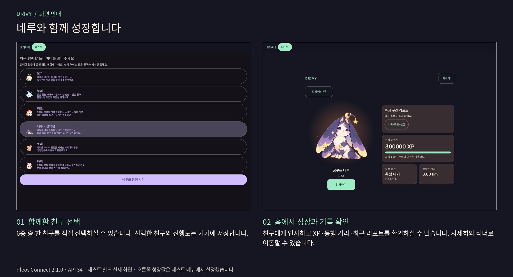
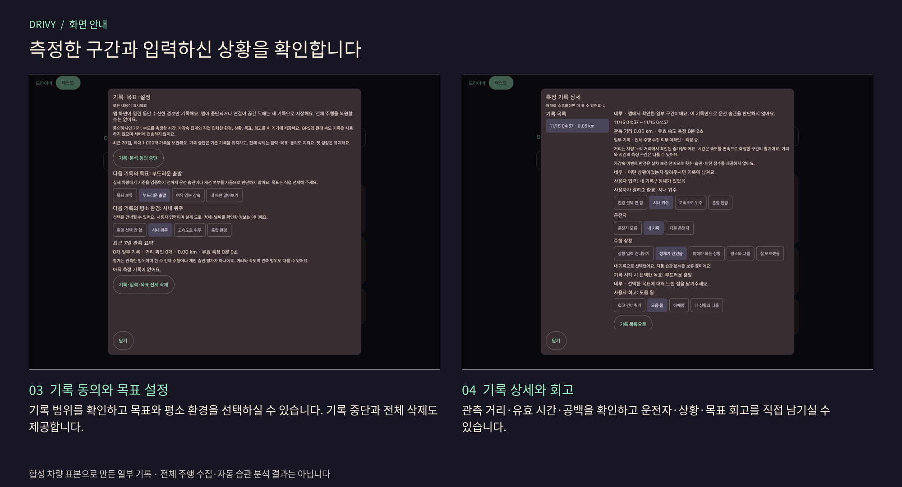
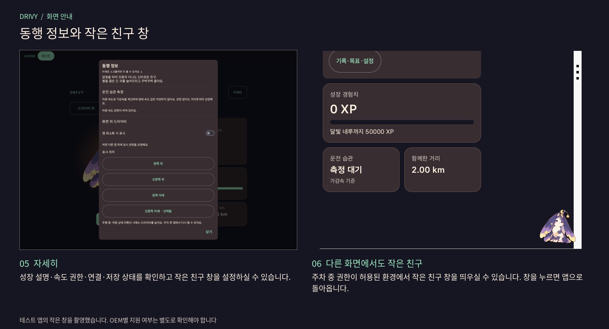
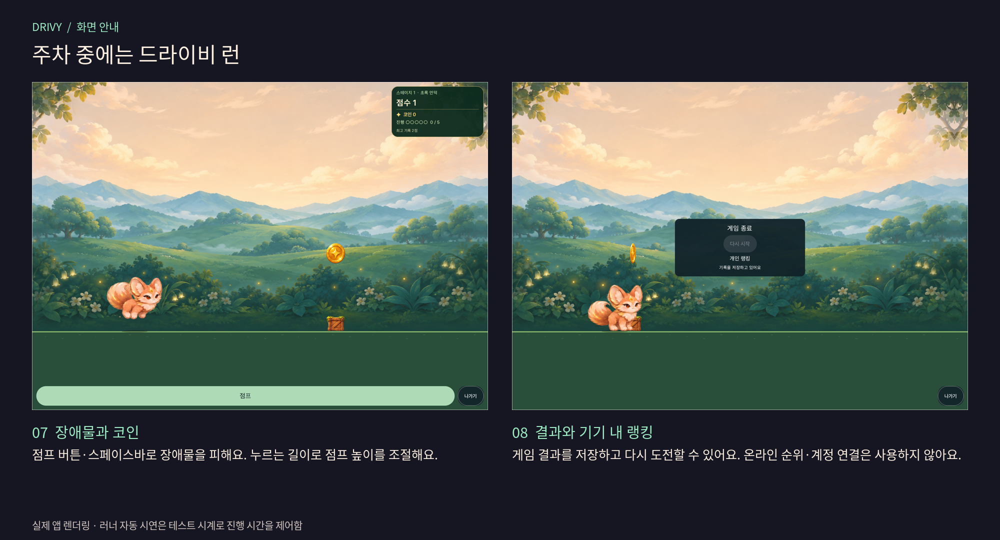
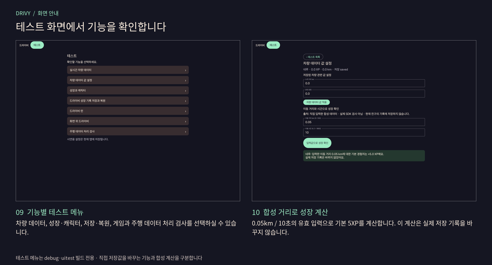

# DRIVY · 드라이비

**차량에서 확인한 주행 데이터로 친구를 키우고, 주차 후 캐릭터와 측정 기록·목표를 돌아보는 Pleos Connect 앱입니다.**

Kotlin·Jetpack Compose로 구현한 AAOS 차량용 앱입니다. 실제 차량 검증 전의 프로토타입으로, 전체 주행 수집·자동 습관 분석·안전운전 인증을 제공하지 않습니다.

## 화면과 시연

대표 캐릭터인 네루로 친구 선택, 성장, 리포트와 게임 화면을 안내합니다. 테스트 값과 합성 차량 입력이 포함되어 있습니다.







[핵심 기능 시연 영상 보기 · MP4](docs/videos/drivy-demo.mp4) · [구간별 설명과 테스트 절차](docs/testing.md)

영상은 네루로 촬영한 기능별 앱 화면과 하단 설명으로 구성되어 있습니다. 합성 입력, 직접 설정한 성장값, 화면 재생성, 새 프로세스 복원을 구분합니다. 테스트 메뉴는 release 빌드에 표시되지 않습니다.

## 주요 기능

### 친구와 성장

- 모카·누리·피코·네루·네루·라피 중 한 친구를 선택합니다. 인사·눈 깜빡임·종별 모션과 세 성장 모습을 제공합니다.
- 유효 누적 거리 증가량 1km당 기본 100XP를 얻습니다. 가감속 기반 게임 점수는 추가 보너스에 영향을 주며 기본 XP를 차감하지 않습니다.
- 50,000XP부터 2단계, 300,000XP부터 3단계입니다. 펫·거리·XP는 기기 내부에 저장하고 앱 재실행 후 복원합니다.
- 수신 공백·비정상 급증·역순·누적계 감소를 유효 성장으로 채우지 않습니다. 게임 점수는 실차 보정이 끝난 운전 안전 평가가 아닙니다.

### 측정 구간 리포트

- `기록·목표·설정`에서 별도로 동의하면 앱이 수신한 일부 구간의 거리·유효 속도 측정 시간·공백과 사용자 입력을 보관합니다.
- 직접 선택한 목표·평소 환경·내 기록 여부·당시 상황·목표 회고를 수정하거나 건너뛸 수 있습니다. 최근 기록 상세와 최근 7일의 관측 합계를 제공합니다.
- 캐릭터는 관측 범위와 한계를 설명합니다. 자동 습관 판단·개선률·개인화 코칭은 아직 제공하지 않습니다.
- 앱 중단·재연결 이후에는 별도 구간을 시작합니다. 앱이 관측하지 못한 이동을 복원하거나 전체 여정으로 합치지 않습니다.
- 최근 30일·최대 1,000개 기록을 앱 실행 중 정리합니다. 동의 중단은 기존 기록을 유지하며 전체 삭제는 입력·목표·회고·동의를 함께 지웁니다. 펫 성장은 유지됩니다.
- GPS·원시 속도 시계열·서버 전송은 사용하지 않습니다. 저장 실패·손상·삭제 실패는 화면에 표시합니다.

### 주차 중 교감과 게임

- `자세히`에서 성장 설명·속도 권한·저장·차량 연결 상태와 작은 친구 창 설정을 확인합니다.
- 지원 환경에서 다른 앱 위에 표시 권한을 부여하면 주차 중 작은 친구 창을 띄우고 위치를 옮기거나 눌러 앱으로 돌아올 수 있습니다. 기기·OEM별 지원은 다릅니다.
- `드라이비 런`은 장애물을 피하고 코인을 모으는 러너입니다. 화면의 점프 버튼 또는 스페이스바를 사용하며, 누르는 길이에 따라 점프 높이가 달라집니다. 기기 내 랭킹을 저장합니다.
- Car UX 제한·상태 미확인에서는 펫 조작·리포트·테스트·게임을 제한하고 작은 창을 숨깁니다.

## APK와 실행

| 파일 | 용도와 상태 |
| --- | --- |
| [drivy-signed-release.zip](https://github.com/silleruss/drivy-public/releases/download/submission-2026-11-15/drivy-signed-release.zip) | 서명된 제출용 APK `이승룡_drivy_release.apk`가 들어 있습니다. 압축을 풀어 사용하세요. |
| [DRIVY_demo.apk](https://github.com/silleruss/drivy-public/releases/download/submission-2026-11-15/DRIVY_demo.apk) | 설치 가능한 별도 테스트 앱입니다. 패키지는 `io.github.silleruss.drivy.uitest`이며 debug 서명과 테스트 메뉴를 포함합니다 |
| [DRIVY_release-unsigned.apk](https://github.com/silleruss/drivy-public/releases/download/submission-2026-11-15/DRIVY_release-unsigned.apk) | 서명 전 release 빌드를 확인하실 수 있습니다. 서명 없이 설치할 수 없으며 최종 제출용 서명 APK는 아닙니다 |

**제출 파일명은 `이승룡_drivy_release.apk`입니다.** 서명과 인증서 검증을 마쳤으며 별도 환경에서의 설치·재실행 검증은 아직 완료하지 않았습니다. 키는 저장소에 포함하지 않습니다.

서명된 APK는 GitHub의 파일당 100MB 제한을 넘어 [GitHub Releases](https://github.com/silleruss/drivy-public/releases/tag/submission-2026-11-15)에 별도로 제공합니다. GitHub가 한글 파일명을 변경하므로, ZIP을 내려받아 압축을 풀면 요청하신 `이승룡_drivy_release.apk`를 얻을 수 있습니다. `apk/SHA256SUMS`로 APK를 확인할 수 있습니다.

### 준비 환경

| 항목 | 확인한 구성 |
| --- | --- |
| 개발 호스트 | macOS / Apple Silicon |
| Pleos Connect 이미지 | Connect 2.1.0, `RELEASE.release_connect_v2.1.0 test-keys` |
| Android | API 34, ARM64 AAOS 에뮬레이터 |
| 디스플레이 | 2560×1440px, 160dpi; 앱은 Pleos 분할 창에서 실행 |
| 빌드 | JDK 21, Gradle 9.3.1, AGP 9.1.1, Kotlin 2.2.10 |
| Android SDK | Platform 36, Build Tools 36.0.0, platform-tools |
| 앱 대상 | minSdk 29 / targetSdk 34 / compileSdk 36 |
| 차량 SDK | Vehicle 2.3.2 / NaviHelper 3.0.5 |

공식 [Pleos 개발 환경 안내](https://appdevchallenge.auto-hmg.io/guide/development)에 따라 Android Studio와 Connect AVD를 준비합니다. SDK·에뮬레이터 이미지·인증정보는 이 저장소에 포함하지 않습니다. 일반 Android 전화 에뮬레이터에서는 차량 SDK 수신을 재현할 수 없습니다.

### 테스트 앱 설치

주차 상태에서 실행합니다. 아래 장치 번호는 `adb devices` 결과로 바꿉니다.

```sh
export ANDROID_HOME="$HOME/Library/Android/sdk"  # 실제 SDK 경로로 변경
source scripts/android-env.sh
adb devices
curl -fL https://github.com/silleruss/drivy-public/releases/download/submission-2026-11-15/DRIVY_demo.apk -o apk/DRIVY_demo.apk
adb -s emulator-5554 install -r apk/DRIVY_demo.apk
adb -s emulator-5554 shell am start --user current \
  -n io.github.silleruss.drivy.uitest/io.github.silleruss.drivy.MainActivity
```

- 처음에는 함께할 친구를 선택합니다. 속도 권한은 `자세히`에서 용도를 확인한 뒤 직접 요청합니다.
- 속도 권한이 없거나 값이 미지원이면 게임 점수는 측정 대기로 표시합니다. 유효 거리의 기본 성장과 별도로 구분합니다.
- 작은 친구 창은 `자세히`의 표시 설정과 OS의 다른 앱 위에 표시 권한이 필요합니다.
- 기존 설치와 서명이 다르면 삭제 대신 인증서를 먼저 확인하세요. `install -r`은 동일한 서명일 때 데이터를 유지합니다.

### 소스 빌드

```sh
export ANDROID_HOME="$HOME/Library/Android/sdk"  # 실제 SDK 경로
source scripts/android-env.sh
./Android/gradlew -p Android :app:assembleDebug :app:assembleRelease \
  :app:assembleUitest :app:assembleUitestAndroidTest \
  :app:testUitestUnitTest :app:lintDebug :app:lintRelease --max-workers=2
```

- Android Studio에서는 `Android/`를 엽니다. Gradle JDK를 21로 지정합니다.
- SDK 경로는 `ANDROID_HOME` 또는 Git 제외 파일 `Android/local.properties`의 `sdk.dir`로 지정합니다.
- 의존성 다운로드를 위한 네트워크가 필요합니다. 현재 앱의 Vehicle·NaviHelper 초기화에는 프로젝트 Secret 주입을 사용하지 않습니다.
- debug: `Android/app/build/outputs/apk/debug/app-debug.apk`
- 별도 테스트 앱: `Android/app/build/outputs/apk/uitest/app-uitest.apk`
- 서명 전 release: `Android/app/build/outputs/apk/release/app-release-unsigned.apk`
- `scripts/run-pleos.sh`는 설치된 AVD를 실행하는 도구입니다. 기본 AVD명은 `Drivy_Pleos_API34`이며 `DRIVY_AVD_NAME`으로 변경합니다. APK를 빌드·설치하지는 않습니다.

## 테스트와 검증 범위

2026-11-15 공개 제출 소스에서 단위 테스트 **72개**, 리포트·테스트 메뉴·Activity 수명주기 Android 검사 **10개**가 통과했습니다. debug·release lint 오류는 0개이며 각 경고 19개가 남아 있습니다. 테스트 빌드와 정상 앱은 패키지를 분리했습니다.

[테스트 화면으로 확인하는 단계·기대 결과·저장 영향](docs/testing.md)을 제공합니다. 시연 녹화의 차량·UX 합성 입력은 실차 보정이나 전체 주행 수집 검증을 대신하지 않습니다.

미검증 범위는 실차별 신호 주기·이벤트 임계값, OEM별 수명주기·작은 창 정책, 자동 습관 분석 효과, 최신 버전의 장시간 운용과 서명된 APK의 독립 설치입니다. Virtual Console 연결이 비활성인 경우 실제 SDK 값 변경 검사는 재시도 대상으로 남깁니다.

## 소스 구성과 권리

- `Android/`: 앱 소스·필수 런타임 자산·단위/화면 테스트·Gradle Wrapper
- `scripts/`: SDK 환경 설정과 AVD 실행
- `docs/images/`, `docs/videos/`: 이번 제출 버전의 화면 안내와 시연
- `docs/testing.md`: 재현 절차와 영상 구간
- `apk/`: Releases 다운로드 안내와 APK 체크섬 (바이너리는 GitHub Releases에 제공)

이전 프로토타입·이미지 시안·작업 계획·개인정보가 포함된 신청서·SDK·캐시·키·로컬 저장 파일은 포함하지 않습니다. 앱에는 원격 분석·광고·클라우드 동기화를 추가하지 않았습니다. 라이브러리와 자산의 권리는 [제삼자 고지](THIRD_PARTY_NOTICES.md)를 참조하세요.
